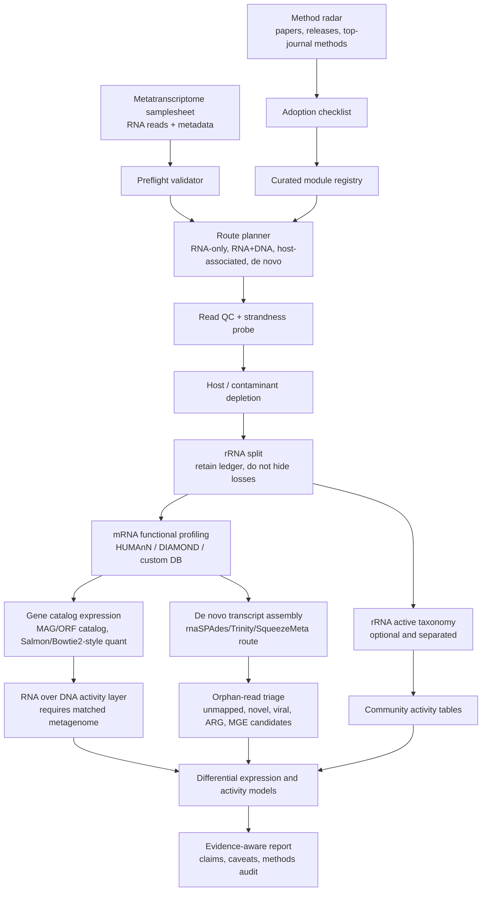

# Automated Metatranscriptome Pipeline

一个面向公共复用和收藏传播的自动化宏转录组分析平台。它不是简单把 RNA-seq、HUMAnN、SqueezeMeta 或 SAMSA2 串起来，而是专门解决宏转录组最容易踩坑的地方：rRNA 残留、宿主污染、DNA/RNA 证据混淆、参考库偏倚、低丰度表达、差异表达误判，以及“检测到转录本就说过程发生”的过度解释。

## Why This Should Be Useful

宏转录组用户通常卡在这些问题上：

- **不是所有 RNA reads 都该进入同一个分析口径**：rRNA 可用于活跃群落线索，mRNA 才更适合功能表达。
- **只有 RNA 没有 DNA 时，很难区分“表达升高”和“生物量变多”**。
- **参考库能解释的 reads 有偏倚**，未比对 reads 可能正是新功能、新病毒或未培养类群。
- **常规 RNA-seq pipeline 假设单一参考基因组**，但宏转录组是多物种、多基因组、多拷贝、多映射场景。
- **常规宏基因组 pipeline 偏向潜能**，但宏转录组要报告 activity evidence，又不能越界成 process proof。

本项目的过人之处是把这些判断前置成自动化规则：先判断项目适合走哪条路线，再运行对应模块，最后用证据等级约束解释。

## Main Workflow



## What Makes It Different

- **Route planner**: 自动判断 RNA-only、matched metagenome、host-associated、de novo、gene-catalog-guided 等分析路线。
- **rRNA ledger**: rRNA 不只是“删掉”，而是记录残留比例、分类用途和 mRNA 损失风险。
- **RNA/DNA activity layer**: 有配对宏基因组时，自动把 transcript abundance 与 gene/genome abundance 分开，避免把丰度变化误读成表达变化。
- **Orphan-read triage**: 对未比对 reads 单独建队列，面向新基因、病毒、ARG、MGE 或数据库缺口，而不是直接丢弃。
- **Evidence ladder**: 把 active taxa、expressed gene、pathway transcript、RNA/DNA activity、process validation 分成不同证据等级。
- **Method radar**: 周期性追踪 HUMAnN、nf-core/rnaseq、SqueezeMeta、SAMSA2、SortMeRNA、DRAM/eggNOG 等来源，候选方法先进入 review queue，不盲目升级默认流程。
- **Shareable first page**: README 第一屏给出清晰流程图、解决的问题和一键命令，面向 GitHub 收藏而设计。

## Quick Start

```bash
git clone https://github.com/rsuag/automated-metatranscriptome-pipeline.git
cd automated-metatranscriptome-pipeline

make validate
make plan
make radar
make summarize
```

Real compute routes:

```bash
make run-qc
make run-functional
make run-expression
```

Before real analysis, edit:

- `config/project.yaml`
- `config/samplesheet_metat.csv`
- `config/databases.csv`
- `config/params_functional.yml`
- `config/params_expression.yml`

## Analysis Routes

| Route | Use when | Main outputs | Main caveat |
| --- | --- | --- | --- |
| RNA-only functional | no matched metagenome | expressed gene/pathway profiles | cannot separate activity from biomass |
| RNA + DNA activity | matched metagenome or MAG/gene catalog exists | RNA/DNA-normalized activity layer | normalization depends on DNA catalog quality |
| Host-associated | host RNA expected | host-depleted microbial RNA and host contamination ledger | privacy and host-reference version must be explicit |
| De novo | reference coverage is poor | transcript contigs and orphan-gene candidates | harder quantification and annotation |
| rRNA activity | rRNA retained or residual | active taxonomy signal | not mRNA functional expression |
| Specialized risk | ARG, virulence, MGE, viral focus | expressed risk markers | expression is not clinical/process proof |

## Known Weaknesses in Existing Workflows

| Existing pattern | Weakness | This pipeline response |
| --- | --- | --- |
| General RNA-seq workflow | assumes one organism and one reference annotation | route planner separates host, microbial and de novo paths |
| Functional profiler only | leaves QC, rRNA, host, differential models and interpretation to users | preflight, ledger, audit and evidence ladder |
| Metagenome-first workflow | treats RNA as another abundance table | explicit RNA/DNA activity layer and transcript-specific caveats |
| De novo-only workflow | misses reference-guided quantification and comparability | hybrid route supports gene catalog and orphan queue |
| Single database annotation | strong reference bias | multi-database registry plus orphan-read triage |
| Fully automatic defaults | can promote new tools too early | method radar uses staged adoption: watch, benchmark, optional, default |

## Output Philosophy

The report should not just say what was found. It should say what the evidence can and cannot support:

- active taxon signal
- expressed gene family
- expressed pathway
- genome-normalized transcriptional activity
- differential expression after metadata-aware modeling
- process-level validation, only when external evidence exists

## Sources This Design Builds On

- [HUMAnN](https://github.com/biobakery/humann) provides functional profiling for metagenomic or metatranscriptomic reads and outputs gene families, reactions, pathways and MetaPhlAn profiles.
- [nf-core/rnaseq](https://nf-co.re/rnaseq) shows mature RNA-seq automation patterns: samplesheet input, QC, trimming, rRNA removal, multiple quantification routes and MultiQC reporting.
- [SqueezeMeta](https://github.com/jtamames/SqueezeMeta) supports metagenomics/metatranscriptomics, co-assembly, MAGs, annotation, quantification and de novo metatranscriptome routes.
- [SAMSA2](https://github.com/transcript/samsa2) is a metatranscriptome-focused workflow built around DIAMOND and customizable databases.

## Repository Layout

```text
.
├── bin/                         # pipeline launchers
├── config/                      # project, samplesheet, database and radar configs
├── docs/                        # landscape, gaps and reliability model
├── scripts/                     # validators, planner, radar and reporting utilities
├── Makefile                     # common entry points
└── README.md                    # GitHub landing page
```

## Current Status

This is a public-facing scaffold and reliability layer. It is designed to be filled with real FASTQ paths, databases and compute profiles, then extended into executable Nextflow/Snakemake modules.

