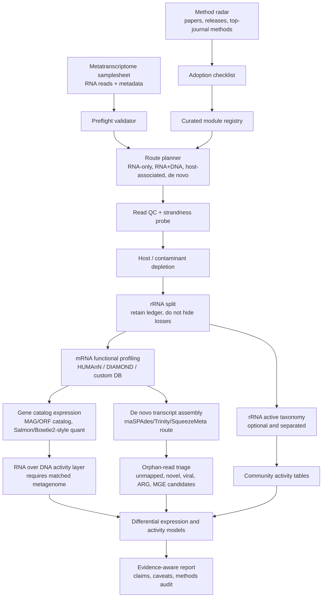

# Automated Metatranscriptome Pipeline

A reusable metatranscriptomics analysis scaffold focused on common failure points: residual rRNA, host contamination, confusion between DNA and RNA evidence, reference-database bias, low-abundance expression, differential-expression errors, and claims that transcript detection alone proves a biological process.

## Why This Should Be Useful

Metatranscriptomics users often face these questions:

- **RNA reads have different roles:** rRNA can inform active-community composition; mRNA is more suitable for functional-expression analysis.
- **RNA-only studies cannot readily separate higher expression from greater biomass** without matched DNA evidence.
- **Reference databases are incomplete:** unmapped reads may represent novel functions, viruses, or uncultivated taxa.
- **Standard RNA-seq pipelines often assume one reference organism:** metatranscriptomes involve many taxa, genomes, gene copies, and ambiguous mappings.
- **Metagenomics measures potential:** metatranscriptomics adds expression evidence but does not establish a process rate by itself.

The project makes these decisions explicit: choose an appropriate route, run its modules, and keep interpretations within the available evidence.

## Main Workflow



## What Makes It Different

- **Route planner:** choose among RNA-only, matched metagenome, host-associated, de novo, and gene-catalog-guided routes.
- **rRNA ledger:** record residual rRNA, its taxonomic use, and possible mRNA loss instead of hiding discarded reads.
- **RNA/DNA activity layer:** keep transcript abundance separate from gene or genome abundance when matched metagenomes exist.
- **Orphan-read triage:** examine unmapped reads for novel genes, viruses, ARGs, MGEs, or database gaps.
- **Evidence ladder:** distinguish active-taxon signals, expressed genes, pathway transcripts, RNA/DNA activity, and process validation.
- **Method radar:** track tools such as HUMAnN, nf-core/rnaseq, SqueezeMeta, SAMSA2, SortMeRNA, and DRAM/eggNOG; review candidates before changing defaults.
- **README overview:** show the workflow, its use cases, and the first runnable commands near the top.

## Quick Start

```bash
git clone https://github.com/rsuag/automated-metatranscriptome-pipeline.git
cd automated-metatranscriptome-pipeline

make validate
make plan
make radar
make summarize
```

Real compute routes:

```bash
make run-qc
make run-functional
make run-expression
```

Before real analysis, edit:

- `config/project.yaml`
- `config/samplesheet_metat.csv`
- `config/databases.csv`
- `config/params_functional.yml`
- `config/params_expression.yml`

## Analysis Routes

| Route | Use when | Main outputs | Main caveat |
| --- | --- | --- | --- |
| RNA-only functional | no matched metagenome | expressed gene/pathway profiles | cannot separate activity from biomass |
| RNA + DNA activity | matched metagenome or MAG/gene catalog exists | RNA/DNA-normalized activity layer | normalization depends on DNA catalog quality |
| Host-associated | host RNA expected | host-depleted microbial RNA and host contamination ledger | privacy and host-reference version must be explicit |
| De novo | reference coverage is poor | transcript contigs and orphan-gene candidates | harder quantification and annotation |
| rRNA activity | rRNA retained or residual | active taxonomy signal | not mRNA functional expression |
| Specialized risk | ARG, virulence, MGE, viral focus | expressed risk markers | expression is not clinical/process proof |

## Known Weaknesses in Existing Workflows

| Existing pattern | Weakness | This pipeline response |
| --- | --- | --- |
| General RNA-seq workflow | assumes one organism and one reference annotation | route planner separates host, microbial and de novo paths |
| Functional profiler only | leaves QC, rRNA, host, differential models and interpretation to users | preflight, ledger, audit and evidence ladder |
| Metagenome-first workflow | treats RNA as another abundance table | explicit RNA/DNA activity layer and transcript-specific caveats |
| De novo-only workflow | misses reference-guided quantification and comparability | hybrid route supports gene catalog and orphan queue |
| Single database annotation | strong reference bias | multi-database registry plus orphan-read triage |
| Fully automatic defaults | can promote new tools too early | method radar uses staged adoption: watch, benchmark, optional, default |

## Output Philosophy

The report should not just say what was found. It should say what the evidence can and cannot support:

- active taxon signal
- expressed gene family
- expressed pathway
- genome-normalized transcriptional activity
- differential expression after metadata-aware modeling
- process-level validation, only when external evidence exists

## Sources This Design Builds On

- [HUMAnN](https://github.com/biobakery/humann) provides functional profiling for metagenomic or metatranscriptomic reads and outputs gene families, reactions, pathways and MetaPhlAn profiles.
- [nf-core/rnaseq](https://nf-co.re/rnaseq) shows mature RNA-seq automation patterns: samplesheet input, QC, trimming, rRNA removal, multiple quantification routes and MultiQC reporting.
- [SqueezeMeta](https://github.com/jtamames/SqueezeMeta) supports metagenomics/metatranscriptomics, co-assembly, MAGs, annotation, quantification and de novo metatranscriptome routes.
- [SAMSA2](https://github.com/transcript/samsa2) is a metatranscriptome-focused workflow built around DIAMOND and customizable databases.

## Repository Layout

```text
.
├── bin/                         # pipeline launchers
├── config/                      # project, samplesheet, database and radar configs
├── docs/                        # landscape, gaps and reliability model
├── scripts/                     # validators, planner, radar and reporting utilities
├── Makefile                     # common entry points
└── README.md                    # GitHub landing page
```

## Current Status

This is a public-facing scaffold and reliability layer. It is designed to be filled with real FASTQ paths, databases and compute profiles, then extended into executable Nextflow/Snakemake modules.

